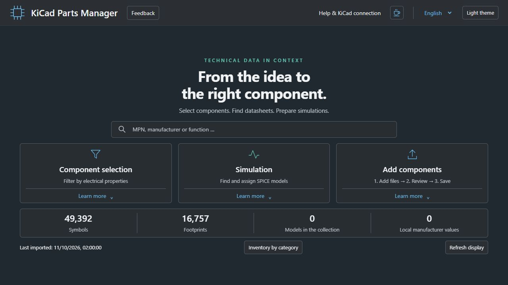

# KiCad Parts Manager – Windows Beta 1

Find, select and organise electronic parts for KiCad using electrical parameters, categories and symbol/footprint previews. Import component files and assign local SPICE models with explicit pin mapping. No runtime AI, cloud account or central database is required.

**[Website and quick-start guide](https://haraldstraub.github.io/kicad-parts-manager-public/)**

## Windows: download and start

**[Download the complete Windows package with Release-DB](https://github.com/HaraldStraub/kicad-parts-manager-public/releases/download/v0.1.0-beta.1/KiCad-Parts-Manager-0.1.0-beta.1-Windows.zip)** · [All downloads and SHA256 checksums](https://github.com/HaraldStraub/kicad-parts-manager-public/releases/tag/v0.1.0-beta.1)

1. Install Python 3.11 or later and KiCad. Tested with Windows 11, Python 3.14 and KiCad 10.0.6; source tests also run with Python 3.13. Other configurations may behave differently.
2. Extract the entire ZIP into a new writable folder, such as `Documents\KiCad-Parts-Manager`. Do not start the application inside the ZIP.
3. Double-click `Start-KiCad-Parts-Manager.cmd`. First setup creates a separate Python environment and needs internet access to download dependencies. The browser opens the local application.
4. Run `Desktop-Verknuepfung-erstellen.cmd` to create a desktop shortcut. Use it to reopen the application after closing the browser.
5. Follow the [installation guide](docs/INSTALLATION.md) to connect the included libraries and your KiCad project. SQLite ODBC is a separate requirement for CERN database libraries; installing additional software may require administrator rights.

End users need the complete Windows ZIP above. GitHub **Code → Download ZIP** contains sources only, without the Release-DB. Extract into a writable folder, run the Start CMD and optionally create the desktop shortcut. Python/KiCad are separate prerequisites; first setup downloads dependencies into a local venv. Instructions and uninstall/data retention: [INSTALLATION.md](docs/INSTALLATION.md).

## Included data

**Release-DB:** 66,149 library catalog entries: 49,392 symbols/parts and 16,757 standalone footprints from CERN, KiCad, SparkFun, DigiKey, DigiKey Partner and Seeed. Eight synthetic demonstration parts and illustrative models are separate examples. The maintainer's **private database**, personal imports and private Git history are excluded. No direct Würth manufacturer collection or additional vendor PDF/3D/SIM collections are bundled. Parts named after manufacturers may occur in the independently licensed open libraries.

All included sources retain their own licences and attribution. Native library files provide previews on demand. Users maintain their own local collection; there is no central public database.

## Features and limitations

- Search words in any order; electrical filters, numerical sorting and category selection.
- Import ZIP/symbol/footprint/PDF/STEP/SPICE files, review the proposed category and enter parameters. Existing parts can be supplemented; duplicates are identified. No automatic guessing of ambiguous pins.
- Local model selection and pin mapping; KiCad placement and a diode DC simulation were accepted in the isolated Windows test. Basic checks do not certify electrical accuracy or model suitability.
- German/English, light/dark themes, local data edits, desktop launcher and data-preserving uninstall.
- [Report a bug](https://github.com/HaraldStraub/kicad-parts-manager-public/issues/new?template=bug_report.md) or [suggest an improvement](https://github.com/HaraldStraub/kicad-parts-manager-public/issues/new?template=feature_request.md). The Feedback button opens a prefilled GitHub form after your review; you submit it yourself. A GitHub account is required; public Issues are public.

Known beta limits: 55 upstream footprint references are missing; generic symbols may have no fixed footprint; some categories remain broad/unassigned. Check 3D placement and all electrical assumptions in KiCad. No live price/stock API or automatic conflict-aware data-package merge. Linux is experimental and not accepted. KiCad can use its bundled ngspice library; the application's optional calculation check may require a separate ngspice console executable.

Updates: back up your own data and extract a new package separately. Never overwrite your own database with the Release-DB. [Release notes](RELEASE_NOTES.md), [security reporting](SECURITY.md), [contributing](CONTRIBUTING.md).

## Licences and validation

Program code: **GPL-3.0-only**, [LICENSE](LICENSE). Libraries retain separate rights: [third-party notices](THIRD_PARTY_NOTICES.md), included source manifests and license files. [Disclaimer in German and English](DISCLAIMER.md). This is an independent project; no library-provider endorsement or electrical guarantee is implied.

Baseline: 408 Python and 142 JavaScript tests passed (three optional skips); isolated setup/import/reimport/data persistence/shortcut/uninstall preview tested. Full test-candidate startup: 15.22 s first cache, 2.92 s cached; timing depends on hardware. This was isolated testing on the development computer, not acceptance on a second clean Windows PC. Online CI and release checks are visible on GitHub.

Maintainer: [Harald Straub](https://github.com/HaraldStraub). Matching sources are in this repository and the source ZIP accompanying the release.

Planned improvements: [Backlog](docs/BACKLOG.md).
